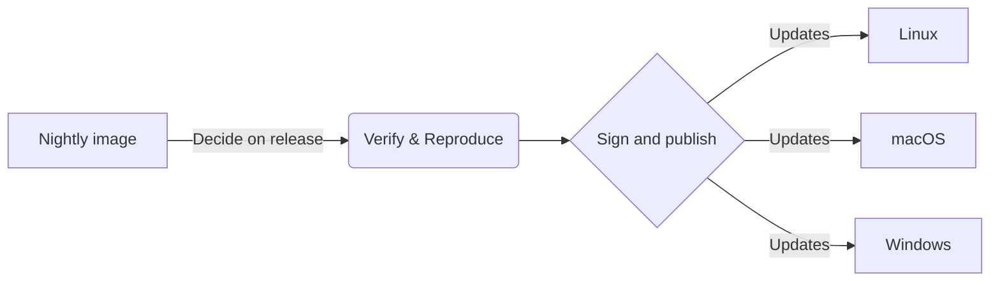

## Dangerzone

Making documents safe

  

---
transition: fade-out
---

# What is Dangerzone?

A tool to render any document into a harmless document.

<v-clicks>

**How it works:**

1. Open the document in a hardened sandbox
2. Take a picture of each page
3. Construct a PDF from those images
4. Optionally, perform character recognition (OCR) on top

</v-clicks>

---
---

# The Sandbox

The sandbox is where potentially dangerous documents are processed safely.

<v-clicks>

- **A container** - Isolated environment
- **Running LibreOffice and a PDF reader** - Handles various document formats
- **Offline with restrictions** - No network access, limited capabilities

This isolation protects your system from malicious documents.

</v-clicks>

---
layout: image-right
image: /assets/goals.jpg
---

# Problem #1

**Software inside the container needs to be kept up to date**

<v-clicks>

CVEs happen frequently:
- LibreOffice
- Debian
- Large attack surface

Dangerzone releases take significant work - we can't issue a new release for every container update.

</v-clicks>

---
---

# Solution #1: Auto-updating Sandbox

Independent container updates that work automatically.

<v-clicks>

- **Signed with FPF-owned keys** - You can trust the source
- **Reproducible builds** - Anyone can verify the container matches the source

</v-clicks>

---
layout: image-right
image: /assets/roadmap.jpg
---

# Problem #2

**The Sandbox needs Docker Desktop (on macOS and Windows)**

<v-clicks>

This creates issues:
- Another installation step for users
- Needs to be kept up to date to avoid exploits
- Licensing concerns

</v-clicks>

---
---

# Solution #2: Embedded Podman

We're embedding Podman directly in our macOS and Windows builds!

<v-clicks>

**Benefits:**
- No separate Docker Desktop installation needed
- Simpler user experience
- No licensing issues
- Full control over the container runtime

</v-clicks>

---
layout: center
---

# Help us test!

We need your help testing these new features.

---
layout: image
image: /assets/discussion.jpg
---

