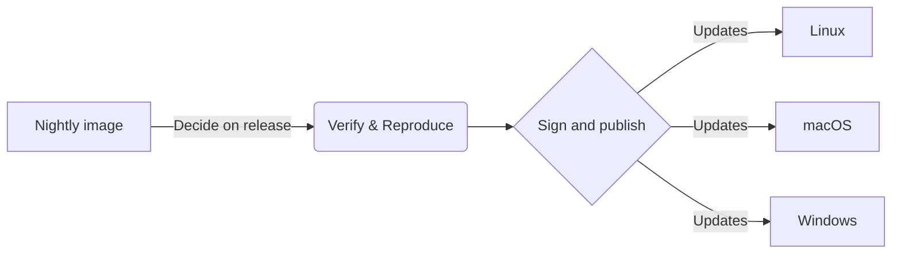
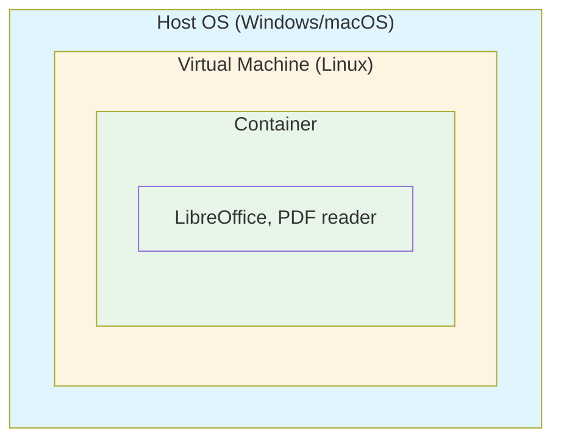

## Dangerzone: making documents safe

Our next release needs **YOU**!

  

---
transition: fade-out
---

# What is Dangerzone?

A tool to render any document into a harmless document.

**How it works:**

<v-clicks>

1. Open the document in a hardened sandbox
2. Take a picture of each page
3. Construct a PDF from those images
4. Optionally, perform character recognition (OCR) on top

</v-clicks>

---

# The sandbox

The sandbox is where potentially dangerous documents are processed safely.

<v-clicks>

- **A container** - Isolated environment
- **Running LibreOffice and a PDF reader** - Handles various document formats
- **Offline with restrictions** - No network access, limited capabilities

This isolation protects your system from malicious documents.

</v-clicks>

---
layout: image-right
image: /assets/San_Andreas_Fault_Aerial_View.gif
---

# Problem #1

**Software inside the container needs to be kept up to date**

<v-click>

CVEs happen frequently:

- LibreOffice
- Debian
- Large attack surface

</v-click>

<v-click>
 
Dangerzone releases take significant work:</v-click>

<v-click><li>We can't issue a new release for every container update.</li></v-click>
<v-click><li>Users tend to lag behind</li></v-click>

---
layout: image-right
image: /assets/trust.jpg
---

# Problem #1 (continued)

**We don't prevent supply chain attacks**

<v-clicks>

- We have to trust our build machines
  - An attacker can make sublte changes to our build environment, leading to us shipping malicious software.
- An attacker could steal our key and use it without us knowning

</v-clicks>

---

# Solution #1: Auto-updating sandbox

Independent container updates that work automatically.

<v-clicks>

- **Signed with FPF-owned keys** - You can trust the source
- **Reproducible builds** - Anyone can verify the container matches the source
- **Auditable** - signatures are uploaded to an external log

</v-clicks>

---
layout: center
---

# Some context

---
layout: two-cols-header
---

# Windows and macOS need a VM

Containers rely on Linux kernel features, so on non-Linux systems:

::left::
<v-clicks>

- A lightweight VM provides the Linux kernel
- The container runs inside this VM
- This adds an extra layer between the container and your OS

</v-clicks>

::right::

---

# Problem #2

**The sandbox needs Docker Desktop (on macOS and Windows)**

<v-clicks>

This creates issues:

- Another installation step for users
- Needs to be kept up to date to avoid exploits
- Docker Desktop mounts the host File System
- Licensing concerns (Docker Desktop is not open source)

</v-clicks>

---
layout: image-right
image: /assets/trojan-horse.jpg
---

# Solution #2: Embedded Podman

We're embedding Podman directly in our macOS and Windows builds!

<v-clicks>

**Benefits:**

- No separate Docker Desktop installation needed
- Simpler user experience
- No licensing issues
- Full control over the container runtime

</v-clicks>

---
layout: center
---

# Help us test!

We need your help testing these new features.

- Especially on Windows and macOS
  - where we embed Podman handle the VMs etc.
- Embedding Podman results in quite large packages:
  -  `.dmg` is 1.8Gib
  -  `.msi` is 1.2Gib
- → https://github.com/freedomofpress/dangerzone/releases/tag/v0.10.0-rc1

---
layout: center
---

# Help us test!
https://github.com/freedomofpress/dangerzone/releases/tag/v0.10.0-rc1

---
layout: image-left
image: /assets/discussion.jpg
---

Sources:

- [Cheval de Troie d'après le Virgile du Vatican.jpg](https://commons.wikimedia.org/wiki/File:Cheval_de_Troie_d%27apr%C3%A8s_le_Virgile_du_Vatican.jpg?uselang=fr#Conditions%20d%E2%80%99utilisation)
- [An aerial view of the San Andreas Fault in the Carrizo Plain, Central California](https://fr.wikipedia.org/wiki/Faille#/media/Fichier:San_Andreas_Fault_Aerial_View.gif)
- T[erry Johnston from Grand Rapids, USA, Creative Commons Attribution 2.0](https://commons.wikimedia.org/wiki/File:Trust_(466709245).jpg)